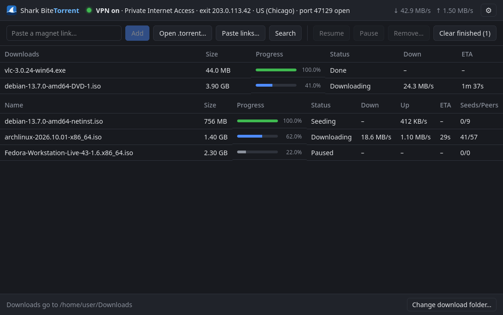
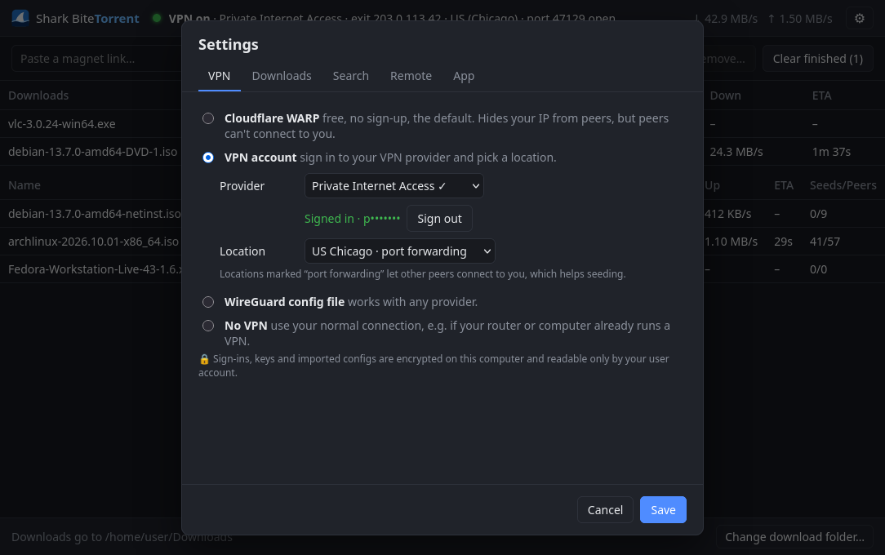
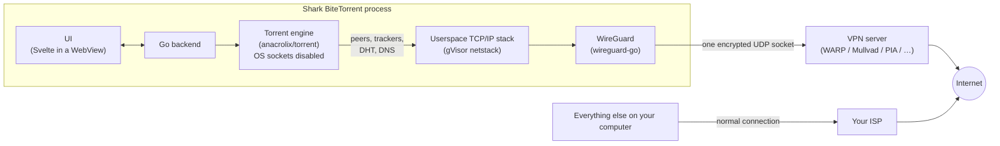

<p align="center">
  
</p>

<h1 align="center">Shark BiteTorrent</h1>

<p align="center">
  A lightweight BitTorrent client with a VPN built in. Only the torrent client goes through the VPN;<br>
  the rest of your computer keeps its normal connection.
</p>

<p align="center">
  
</p>

---

## Why this exists

Most people who want their torrent traffic on a VPN have two options, and neither is great:

1. **Run a system-wide VPN.** Everything on the PC (games, streaming, work apps) now goes through it too, often slower or blocked.
2. **Use split tunneling or bind the client to a VPN adapter.** That's fiddly to set up, depends on the VPN app, and can **leak your real IP** if the VPN drops and the client falls back to the normal connection.

Shark BiteTorrent puts the VPN **inside the app**. The torrent engine has no network access except through its own WireGuard tunnel, so:

- nothing else on your computer is affected,
- there's nothing to install system-wide: no network adapter, no driver, no admin rights,
- and if the VPN goes down, torrents stop instead of leaking. That kill switch is a consequence of the design, not a setting you have to remember.

It works out of the box with **free Cloudflare WARP**, so there's protection from the first launch, and you can switch to a paid VPN provider at any time.

## Features

**VPN**
- 🦈 **Per-app VPN**: only this app's traffic uses the tunnel.
- 🆓 **Cloudflare WARP by default**: free, no sign-up, registered automatically on first launch.
- 🔑 **Sign in to your VPN provider**: **Mullvad**, **Private Internet Access**, **NordVPN** and **IVPN**. Pick a server location, or let the app choose one in your own country.
- 🔓 **Automatic port forwarding with PIA**: other peers can connect to you, which means much better seeding. The forwarding is renewed every 15 minutes.
- 📄 **Import any WireGuard `.conf` file**: works with any provider (Proton, AirVPN, …), with an optional forwarded port.
- 🛑 **Kill switch by design**: the torrent engine starts only after the tunnel is verified (exit IP checked) and has no other network path.
- 🚫 **No VPN, if you choose it**: for people whose router or computer already runs a VPN (or who only download legal content). It's an explicit choice in Settings with a warning (including that, like other clients, it may ask your router via UPnP/NAT-PMP to open a port), the header shows an amber **VPN off**, and the app never switches to it by itself: if a VPN fails, downloads stop. The Prowlarr/Jackett proxy refuses connections in this mode; Prowlarr keeps searching on its own connection if the proxy is off.
- 🔒 **Encrypted secrets**: WARP keys, VPN sign-ins and imported configs are encrypted on disk.

**Torrents**
- Magnet links and `.torrent` files: paste, open, drag and drop, or click a magnet link in your browser (links from outside the app wait for you to press **Start**, and nothing is contacted until then, so a web page can't start a download by itself).
- **Choose which files to download** in a torrent.
- **Piece map**: a qBittorrent-style bar showing which pieces are done, downloading, being checked, missing or skipped.
- **Remote control from your phone** (Settings → Remote control, off by default): scan a QR code to pair, then add magnets or `.torrent` files, search, and pause or remove torrents from your phone's browser on the home Wi-Fi. It only runs on the home network you paired on (off on café/hotel/work Wi-Fi) and only answers devices on it; downloads still happen on the computer, through its VPN. Plain HTTP, so others on your Wi-Fi could see its traffic. Optional **Tailscale access** makes it reachable from anywhere by devices signed in to your own Tailscale account, encrypted by Tailscale.
- **Verify files** (right-click): re-reads a torrent's files from disk and checks every finished piece against the torrent's SHA-1/SHA-256 piece hashes, to catch damage after downloading (a bad copy, a failing disk or NAS). Pieces that no longer match are downloaded again. Every piece is already hash-checked as it downloads; this re-checks what's on disk now.
- **.sfv checks**: if a torrent includes `.sfv` files (CRC32 per file), its files are checked against them when it finishes, and again with *Verify files*. Mismatches are reported per file.
- **Malware checks**: every torrent is checked for disguised programs as soon as its file list arrives (e.g. `movie.mp4.exe`, a program named like a film such as `Film 2026 1080p x264.exe`, or a program inside a video torrent). Finished files are marked as downloaded from the internet (Windows SmartScreen and Defender, macOS Gatekeeper and XProtect check them when opened) and scanned with Microsoft Defender on Windows, or ClamAV on Linux and macOS if it's installed ([how to set up ClamAV](docs/clamav.md)). A clean scan means no *known* malware: scanners miss new programs, ClamAV especially (it passed a fake-film `.exe` in testing), so heed the disguised-program warnings whatever the scan says.
- **Search**: search all the sites you've added to your own **Prowlarr** or **Jackett** from inside the app, then double-click a result to download it. It finds Prowlarr or Jackett on the same computer automatically. No sites are built in.
  - **Prowlarr/Jackett through the VPN too** (optional, Settings → Search): the app runs a password-protected SOCKS5 proxy on `127.0.0.1` that leads into its tunnel, and sets Prowlarr to use it (Jackett: copy the shown values into its Proxy settings). **Check it's working** confirms it from the traffic itself: it runs a test search for a random word (so nothing comes from the server's cache) and watches for requests coming through the proxy, on new connections or ones the server already had open. It's a sign that at least one site's search used the proxy, not proof that all did (other traffic Prowlarr sends through it meanwhile counts too). Indexer sites then see the VPN's IP, and their DNS lookups go through the VPN as well. While Shark BiteTorrent is closed, Prowlarr's searches fail instead of going out on your real IP. Prowlarr still reaches Sonarr, Radarr and FlareSolverr on your own network directly, and a site Prowlarr fetches through FlareSolverr is contacted by FlareSolverr itself, outside the VPN, unless you give FlareSolverr a proxy too.
- Pause/resume, and **remove with or without deleting the downloaded files**.
- **Speed limits** that apply immediately.
- **Per-torrent download folders**: changing the folder affects new torrents only, and the choice is remembered.
- Torrents and settings survive restarts. Incomplete files are kept as `.part` files.
- Right-click menu on a torrent: **Show files**, Pause/Resume, Remove.
- **Ask where to save each download** (on by default; *Don't ask again* turns it off): before anything is added, choose its folder (the default, a recent one, or another) and whether to start it now. Links opened from outside the app get the same choice in their banner.

**Direct downloads (Paste links)**
- 📋 **Paste links, a page or a paste**, and the app lists every download in it: magnet links, `.torrent` files, file links, and links to file-hosting sites. It reads what you paste, a web page that lists downloads (a Linux mirror's release folder, an [Internet Archive](https://archive.org) item, a [Project Gutenberg](https://www.gutenberg.org) book), or an encrypted [PrivateBin](https://privatebin.info) paste, which it decrypts on your computer (the key, after the `#`, is never sent). Files and torrents are listed first in natural order (`3.20.2` before `3.20.10`, `part2` before `part10`), with a filter for long lists; you tick what you want.
- **Downloads through the VPN**, like torrents: several connections per file where the server allows it, resumed after a restart or a dropped connection, and if the VPN goes down they wait for it rather than use your normal connection. Finished files are checked for malware like finished torrents.
- **File hosts that only work in a real browser** (Windows for now): their pages open in a browser window of the app's own whose traffic, DNS included, goes through the VPN. The app clicks each page's download button, blocks every pop-up, and downloads the file itself (so it resumes). If a site asks you to prove you're human, you do that in the window and the app carries on; it never tries to get around such checks.
- Multi-select (Ctrl/Shift+click) to pause, resume or remove several at once, and **Clear finished** to tidy the list (the files stay).

**Desktop**
- **Tray icon** with close-to-tray, Pause all / Resume all, and live speeds in the tooltip.
- **Updates**: the app checks GitHub (through the VPN) when it starts and about once a day while it runs, and offers new versions. *Update now* downloads the update, checks it against the release's signed SHA-256 checksums, installs it and restarts the app: on Windows with the installer; on macOS by replacing the app (after checking it's this app, at that version, and that its built-in signature checks out; the signed checksums are what prove where it came from); with the Linux tarball by replacing the program. If you installed with pacman, or the app can't write to its own folder, *Download (verified)* downloads and checks the file instead and saves it for you to install. Releases are signed with a key kept off GitHub (`release.pub`, key ID `F59273E544BB8BA3`), so a hijacked GitHub account couldn't push an update that passes these checks. There's also *Check for updates* in Settings.
- **Single instance**: clicking a magnet link while the app is open sends it to the running window.
- **Windows installer**: per-user, no admin. It registers magnet links and `.torrent` files and cleans up on uninstall.

<p align="center">
  
</p>

## Install

Download the latest build from the [**Releases**](../../releases) page.

| Platform | File | Notes |
|---|---|---|
| **Windows 10/11** | `SharkBiteTorrent-amd64-installer.exe` | Recommended. Installs for your user and registers magnet links. |
| Windows (portable) | `SharkBiteTorrent.exe` | Run from anywhere. Use Settings → *Open magnet links…* to register. |
| **Arch / CachyOS** | `sharkbitetorrent-*.pkg.tar.zst` | `sudo pacman -U sharkbitetorrent-*.pkg.tar.zst` |
| Other Linux | `SharkBiteTorrent-*-linux-x86_64.tar.gz` | Needs GTK 3 and WebKitGTK 4.1. |
| **macOS 13 or later** (Intel + Apple Silicon) | `SharkBiteTorrent-macos-universal.zip` | Unsigned: the first time, macOS blocks it. Go to **System Settings → Privacy & Security → Open Anyway**. |

> **Note:** On Windows 11, the first magnet link you click after installing shows a one-time *"Pick an app"* prompt. Choose Shark BiteTorrent. Windows requires you to confirm this yourself; no installer can skip it.

## How it works



1. **WireGuard runs inside the app.** `wireguard-go` is paired with gVisor's userspace network stack, the same approach Tailscale uses. The app gets a private, in-memory network interface that the operating system doesn't know about.
2. **The torrent engine only has that interface.** All of `anacrolix/torrent`'s own sockets (TCP, uTP, DHT, UPnP, WebRTC) are disabled, and the app supplies tunnel-backed replacements for peer connections, HTTP and UDP trackers and DHT. (Web seeds, HTTP mirrors listed in some torrents, are turned off: the library crashes when such a torrent is removed.)
3. **DNS goes through the tunnel too.** Every lookup the torrent engine makes (trackers, DHT bootstrap) goes to the VPN's DNS server, so your ISP doesn't see which trackers you contact; while the VPN is reconnecting, those lookups are blocked rather than sent to your ISP. The few things that deliberately use your normal connection, listed in [PRIVACY.md](PRIVACY.md), look names up with your system's DNS.
4. **Verification before anything starts.** After connecting, the app fetches its exit IP through the tunnel and checks it: `warp=on` for WARP, and for other providers, an IP different from your real one. Only then does the engine start.

We checked this with the OS's own socket list: while downloading, the app's **only** real network socket is the WireGuard UDP socket to the VPN server.

## Design decisions

| Decision | Why |
|---|---|
| **Go + Wails** (Go backend, web UI in the system WebView) | One small native app per OS without bundling a browser like Electron does. Go has the best in-process WireGuard and torrent libraries. |
| **Userspace WireGuard instead of a TUN adapter** | No driver, no admin rights, nothing system-wide to configure or leak. The kill switch comes for free. |
| **WARP as the default VPN** | Free and needs no account, so users are protected from the first launch. It isn't a privacy VPN (Cloudflare knows who you are), which is why switching providers is one click away. |
| **WARP registration via [wgcf](https://github.com/ViRb3/wgcf)'s library** | Cloudflare rejects requests that don't look like its official app (TLS fingerprinting). wgcf keeps up with that, and using it as a library means updates fix it. |
| **WARP endpoint stored as an IP address** | Some DNS resolvers block `engage.cloudflareclient.com`. A literal IP also avoids a DNS lookup outside the tunnel. |
| **VPN sign-in only where the provider supports it** | Mullvad, PIA and IVPN publish their login flow in official open-source scripts or clients, and NordVPN issues access tokens for manual setups. Proton and AirVPN have no public API, so they use `.conf` import instead of fragile reverse-engineering. |
| **Keep `.conf` import for every provider** | Works with any WireGuard provider, and suits people who'd rather not give the app their login. |
| **Encrypt secrets with the OS key store** | Windows uses DPAPI. macOS and Linux keep a random key in Keychain or the Secret Service (KWallet/GNOME Keyring) and use AES-256-GCM (on a Linux desktop with no keyring, the key goes in a file only the user can read, and Settings says so). A copied settings file is unreadable on another account or machine (except in Linux key-file mode, where a copy of the whole settings folder includes the key), and the user never has to type a master password. Code running as the same logged-in user can still decrypt, as with browser-saved passwords. |
| **Plain file I/O instead of memory-mapping** | anacrolix's default memory-maps files and never unmaps them, so Windows kept removed torrents' files locked and "delete files" failed. A tiny `earlyinit` module switches the library to plain I/O before it initializes. |
| **"Unlimited" speed is a very large finite limit** | With an infinite rate limiter, anacrolix stopped connecting to peers: it saw zero download "tokens" and treated that as no budget. |
| **Per-user installer (no admin)** | Matches the per-user magnet registration, avoids a UAC prompt, and upgrades in place. |
| **Linux release built on Ubuntu 22.04** | Building against older system libraries means one binary runs on current distros (CachyOS/Arch, Fedora) and older ones (Debian, Ubuntu LTS). The Arch package wraps that same binary. |
| **A `nofunding` build flag** | The funding is optional for users, so removing it shouldn't need code changes. One flag strips the sponsor button and referral links, and stops the updater from installing the official (funded) release over it. |
| **"No VPN" is a separate engine path, never a fallback** | VPN mode builds the torrent client with OS sockets disabled and only tunnel-backed dialers; "No VPN" builds a plain client instead. The two never mix, so a VPN failure can't turn into a direct connection. |
| **A local proxy for Prowlarr/Jackett, not a system-wide VPN** | The point of the app is that nothing else on the computer is affected. A proxy lets the search server opt in to the tunnel, and it fails closed: no app, no searches. |
| **A browser window for file hosts, not code for each site** | Many hosts only serve a real browser that a person is using. A window of the app's own works with any of them without per-site code that breaks when a site changes, and it leaves anything that asks for a human to the human. Its traffic goes through a proxy into the app's tunnel that only the app's own processes may use, and it resolves no names itself. The app takes over each download from it, so downloads resume and are checked like the rest. |
| **Search through Prowlarr or Jackett, with no sites built in** | Bundling scrapers for torrent sites would make the app look like a piracy tool and break whenever a site changes. Prowlarr and Jackett are maintained by their own communities, and users choose their own sources (the same model as qBittorrent's search plugins). |

## Limitations

- **WARP can't forward ports**, so peers can't connect to you and seeding is limited. Use PIA, or a provider with port forwarding via `.conf` import.
- **WARP isn't anonymous**: it hides your IP from peers, not your identity from Cloudflare.
- **TCP peers only (no uTP), by choice**: the only uTP library that can run inside the tunnel is an older, slower pure-Go one. TCP already reaches 35–40 MB/s through WARP, so it isn't worth the CPU cost and complexity.
- **macOS:** no tray icon yet (the tray library and Wails both need the main thread), and the app is unsigned.
- **Linux and macOS** now go through the release checks too, with a leak test built for each (run on CachyOS and on macOS 27). Each OS's test sees traffic differently and has its own limits, listed in [RELEASING.md](RELEASING.md). Far fewer people use these builds than the Windows one, so expect rougher edges, and please report problems.
- **Paste links' browser window is Windows-only so far.** On Linux and macOS, links to file hosts' pages say so; direct file links, pages that link to files, pastes and torrents work everywhere. The window's automatic click is generic (the page's most prominent free "download" button, never anything selling something): if a host ignores it, the window asks you to click.
- VPN sign-in follows each provider's official flow and is tested against their real server lists, but not yet with real paid accounts for every provider. Please report problems.

## Build from source

All platforms need:

- **Go 1.26+**: <https://go.dev/dl/>
- **Node.js 22+** (with npm): <https://nodejs.org/>
- **Wails CLI v2.16**:
  ```sh
  go install github.com/wailsapp/wails/v2/cmd/wails@v2.17.0
  ```
  Make sure `$(go env GOPATH)/bin` is on your `PATH`, then check your setup with `wails doctor`.

Clone the repo:

```sh
git clone https://github.com/trevercomb/SharkBiteTorrent.git
cd SharkBiteTorrent
```

### Windows

Requirements: WebView2 (built into Windows 10/11) and, for the installer, [NSIS](https://nsis.sourceforge.io/):

```powershell
winget install GoLang.Go OpenJS.NodeJS.LTS NSIS.NSIS
```

Build:

```powershell
# App only -> build\bin\SharkBiteTorrent.exe
wails build -trimpath -ldflags "-s -w"

# App + per-user installer -> build\bin\SharkBiteTorrent-amd64-installer.exe
wails build -trimpath -ldflags "-s -w" -nsis -installscope user
```

If `makensis` isn't found, add `C:\Program Files (x86)\NSIS` to your `PATH`.

### Linux

**Arch / CachyOS:**

```sh
sudo pacman -S --needed base-devel go nodejs npm gtk3 webkit2gtk-4.1 xdg-utils
```

**Debian / Ubuntu 24.04+** (install Go from go.dev if your distro's is older than 1.26):

```sh
sudo apt install build-essential pkg-config nodejs npm libgtk-3-dev libwebkit2gtk-4.1-dev xdg-utils
```

**Fedora:**

```sh
sudo dnf install golang nodejs npm gtk3-devel webkit2gtk4.1-devel xdg-utils
```

Build. The `webkit2_41` tag selects WebKitGTK 4.1, which current distros ship:

```sh
wails build -trimpath -ldflags "-s -w" -tags webkit2_41
# -> build/bin/SharkBiteTorrent
```

To register magnet links for your user, open Settings → *Open magnet links & .torrent files with Shark BiteTorrent*. That writes a `.desktop` entry and runs `xdg-mime`.

**Make an Arch package** (what the release does):

```sh
v=0.2.0; name=SharkBiteTorrent-$v-linux-x86_64
mkdir -p dist/$name
cp build/bin/SharkBiteTorrent packaging/linux/sharkbitetorrent.desktop dist/$name/
cp build/appicon.png dist/$name/sharkbitetorrent.png
tar -C dist -czf packaging/arch/$name.tar.gz $name
cd packaging/arch && makepkg -si
```

Saved VPN logins on Linux are best protected by a Secret Service keyring; KDE's KWallet and GNOME Keyring both provide one. Without one (common with Hyprland, Sway or i3), the app still works and keeps its key in `~/.config/SharkBiteTorrent/secret.key`, readable only by you.

### macOS

Requirements: Xcode Command Line Tools, plus Go and Node (via Homebrew or the installers above):

```sh
xcode-select --install
brew install go node
```

Build a universal app (Intel + Apple Silicon) for macOS 13 or later (the flags make all of it run there, not only on your own macOS version):

```sh
export CGO_CFLAGS="-mmacosx-version-min=13.0" CGO_LDFLAGS="-mmacosx-version-min=13.0"
wails build -trimpath -ldflags "-s -w" -platform darwin/universal
codesign --force --deep --sign - build/bin/*.app   # ad-hoc signature so it launches
# -> build/bin/SharkBiteTorrent.app
```

Magnet links and `.torrent` files are declared in the app's `Info.plist` (generated from `wails.json`), and macOS registers them when the app is moved to Applications.

### Build without funding links

Add the `nofunding` build tag to any build command above, on any platform:

```sh
wails build -tags nofunding -trimpath -ldflags "-s -w"                    # Windows / macOS
wails build -tags "webkit2_41 nofunding" -trimpath -ldflags "-s -w"     # Linux
```

That build has:

- no sponsor button,
- plain links to every VPN provider (no referral codes, no referral labels),
- an About section that says funding links are turned off,
- update notices that link to the release page instead of installing the official release, which has the links back in.

Everything else is identical. To check it, run `go test -tags nofunding -run TestLinks .`

### Microsoft Store package

The Store version is the same app built with the `store` tag: the Store installs updates and registers magnet links and `.torrent` files from the package manifest, so the app's own updater and registry setup are turned off. To build the `.msix` (from Git Bash, on Windows):

```sh
packaging/msix/build-msix.sh [path/to/windows-sdk/bin/x64]
```

It needs `makeappx.exe` and `makepri.exe` from the Windows SDK (or the `Microsoft.Windows.SDK.BuildTools` NuGet package). The package is unsigned; Partner Center signs it after upload. The package identity in [`packaging/msix/AppxManifest.xml`](packaging/msix/AppxManifest.xml) belongs to the official Store listing, so change it if you publish your own.

### Development

```sh
wails dev                      # live-reloading app; frontend changes apply instantly
go test ./...                  # unit tests (add -short to skip the tests that need the network)
go run ./cmd/tunnelcheck       # bring up WARP and print the exit IP
go run ./cmd/enginecheck -seconds 30 [-down KB/s] [-delete] <magnet|file.torrent>
                               # headless download through the tunnel; ENGINE_STATUS=1 dumps client state
```

### Releases

See [`RELEASING.md`](RELEASING.md) for the release checklist (leak tests, CodeQL, a fresh-eyes audit of the changes). Changes land on `main` as they're made, so building from source always gets the latest. Each user-visible change is noted under **Unreleased** in [`CHANGELOG.md`](CHANGELOG.md); when it's time to ship, that section is renamed to the new version, and the release notes are generated from it (a tag without a CHANGELOG section fails the release).

Pushing a version tag builds Windows, Linux and macOS on GitHub Actions and creates a **draft** Release. The maintainer then signs its `SHA256SUMS.txt` with the release key and publishes it:

```sh
git tag v0.2.1 && git push origin v0.2.1
# after the workflow finishes:
go run ./cmd/releasekey publish v0.2.1
```

The signing key never goes into git or GitHub Actions; a compromised GitHub account must not be able to sign. It's stored on the maintainer's computer as a password-protected minisign key (`~/.sharkbite-release/`, separate from the app's own keyring entry), with a password-protected backup kept offline (`releasekey backup` / `restore`). `publish` only runs from a clean checkout of the tag being released, so the tool doing the signing is the reviewed code. The public half, [`release.pub`](release.pub), is built into the app, and the updater refuses a release whose signature is missing, invalid, or made for a different version. Before signing, `publish` checks every file in the draft against GitHub's build provenance (attestations): each must have been built by this repo's `release.yml`, on a GitHub-hosted runner, from exactly the commit the maintainer's local tag points to, and `SHA256SUMS.txt` must match the hashes it computes itself. Files swapped into the draft, or built from other code or a modified workflow, are refused instead of signed. Anyone can check a download with [minisign](https://jedisct1.github.io/minisign/): `minisign -Vm SHA256SUMS.txt -p release.pub`.

Running the **Release** workflow by hand from the Actions tab builds everything without publishing. Each run also builds the Microsoft Store `.msix` (with build provenance) as an artifact; it isn't attached to the release, because it's only installable after the Store signs it. `releasekey publish` verifies it and hands it over for upload to Partner Center.

### Diagnostic logging

Starting the app with `SBT_LOG_LEVEL=info` (or `debug`) writes the torrent engine's log to standard error, for diagnosing download problems. Passkeys in tracker addresses and magnet links are redacted, but the log does include file paths, torrent names and hashes, and peers' IP addresses, so look through it before sharing it. It's off unless you set the variable.

## Project layout

```
main.go, app.go          Wails entry point; app state, VPN connect/reconnect, torrents
accounts.go              VPN provider sign-in/out (encrypted storage)
links*.go                Sponsor and VPN sign-up links (links.go); the nofunding build flag strips them
tray*.go                 Tray icon (per-OS files)
updater*.go, release.pub In-app updates, checked against the signed release checksums
cmd/releasekey           Maintainer tool: create/back up the signing key, sign and publish a release
cmd/leakcheck            Release check (Windows: admin; Linux, macOS: sudo): every connection and DNS lookup outside the VPN tunnel fails it
internal/tunnel          In-process WireGuard + netstack, .conf parser, exit-IP check
internal/engine          anacrolix/torrent wired to the tunnel; files, limits, removal
internal/warp            Cloudflare WARP registration (via wgcf)
internal/vpnprov         Mullvad, PIA, NordVPN, IVPN sign-in and server selection
internal/secret          Encryption at rest (DPAPI / keyring + AES-GCM)
internal/platform        Open folder, magnet/.torrent registration (Windows/Linux/macOS)
internal/winassoc        Windows registry associations and Default Apps
earlyinit/               Sets the torrent library's file I/O mode before it initializes
frontend/                Svelte 5 + TypeScript UI
packaging/               Linux .desktop file, Arch PKGBUILD, Microsoft Store manifest (msix/)
build/                   Icons, Windows installer script, macOS Info.plist
.github/workflows        Release builds for all three platforms
```

App data (settings, saved torrents, encrypted keys) lives in:

| OS | Location |
|---|---|
| Windows | `%APPDATA%\SharkBiteTorrent` |
| Linux | `~/.config/SharkBiteTorrent` |
| macOS | `~/Library/Application Support/SharkBiteTorrent` |

Downloads default to `Downloads/Torrents` in your home folder.

## Credits

Built on [wireguard-go](https://git.zx2c4.com/wireguard-go/) and [gVisor](https://gvisor.dev/) netstack, [anacrolix/torrent](https://github.com/anacrolix/torrent), [wgcf](https://github.com/ViRb3/wgcf), [Wails](https://wails.io/), [Svelte](https://svelte.dev/), [fyne.io/systray](https://github.com/fyne-io/systray) and [go-keyring](https://github.com/zalando/go-keyring). The PIA certificate and connection flow come from PIA's [manual-connections](https://github.com/pia-foss/manual-connections) scripts.

## How this project is funded

We'd rather tell you upfront than have you find out later.

**What earns money:**
- **Donations** through GitHub Sponsors (the **Sponsor** button on this repo, and *Support development* in the app's Settings → About). Entirely optional.
- **Referral links for two VPN providers: NordVPN and Private Internet Access.** In Settings → VPN account, each provider has a *"Don't have an account? Get …"* link. For these two, it's a referral link: if you buy a subscription through it, the provider pays this project a commission. The price you pay is the same.

**What that means for you:**
- **Every referral link is labelled as one in the app**, right next to the link.
- **The provider's website will know you came from Shark BiteTorrent.** That's how referral tracking works (a code in the link, usually stored in a cookie on their site). The app itself shares nothing with them.
- **No link is ever a recommendation.** Providers are listed alphabetically, and support for a provider is never added, removed or reordered because of a commission.
- **Mullvad and IVPN links are plain links.** Neither runs a referral program, by their own choice. We include them because they're good providers.
- **You never have to pay anything.** The free Cloudflare WARP default and WireGuard config import (for any provider) will always be available.

**What never happens:**
- No ads, no bundled software, no "recommended offers" in the installer.
- **No background traffic from the window (Windows).** The UI runs in Microsoft WebView2, which on its own would contact Microsoft: a Windows-account lookup at startup, text prediction (typed text), Edge config and proxy auto-discovery. The app turns those features off and blocks the window's network layer, using a small patch to go-webview2 (`third_party/go-webview2/PATCHED.md`, checked in CI); the release leak test watches the app and every process it starts.
- **No telemetry or analytics.** The app never sends data to us; there is no server of ours for it to talk to. Its only connections are the torrent network (through the VPN), your VPN provider's API (through the VPN when one is connected; directly only for what you do with a provider while no VPN is up: signing in, connecting, signing out, listing its locations), Cloudflare's trace page to check your exit IP (also once directly when connecting to a non-WARP provider), WARP registration, GitHub for update checks and release notes (through the VPN by default; you can turn the daily check off), and your own Prowlarr or Jackett when you search. [PRIVACY.md](PRIVACY.md) lists exactly when each one can use your normal connection.
- Your data, logins and download history are never sold or shared. See the [privacy policy](PRIVACY.md).

Every link lives in one file, [`links.go`](links.go), so anyone can check exactly what the app links to. To build without any of it, use the `nofunding` build flag (see [Build without funding links](#build-without-funding-links)): no sponsor button, plain provider links and no referral labels. Because this is GPL software, you're free to change or remove anything else too.

## Contributing

Bug reports, ideas and pull requests are welcome. Please open an issue first for big changes.

## License

Shark BiteTorrent is free software, licensed under the **[GNU General Public License v3.0 or later](LICENSE)**.

You can use, study, share and modify it. If you distribute a modified version, you must make its source available under the same license, so forks stay open (no closed-source or adware repackaging).

It includes third-party libraries under MIT, BSD, ISC, Apache-2.0 and MPL-2.0 licenses, all compatible with the GPL. Their notices are in [THIRD_PARTY_LICENSES.txt](THIRD_PARTY_LICENSES.txt), which also ships with every release. To regenerate it after changing dependencies, use [`go-licenses`](https://github.com/google/go-licenses):

```sh
go install github.com/google/go-licenses/v2@latest
go-licenses report .   # lists every Go dependency and its license
```

Please use Shark BiteTorrent only for content you have the right to download and share.
